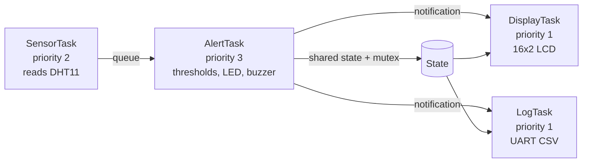

# FreeRTOS Environmental Monitor on STM32 (Blue Pill)

A multi-task environmental monitor for the STM32F103C8T6 "Blue Pill". Separate FreeRTOS tasks read a DHT11 temperature and humidity sensor, check alert thresholds, update an LCD and stream the data over UART.

> **Status:** this code was written as a new implementation of the project idea and has been syntax-checked only. It has **not yet been flashed and tested on a board.** Add your own measurements to the [Results](#results) section after you test it on hardware.

## Features

- Four FreeRTOS tasks with different priorities, connected by a queue, a mutex and task notifications
- DHT11 temperature and humidity measurement every 2 seconds
- Alert LED and buzzer when temperature is above 30 °C or humidity is above 70 % (thresholds in `src/config.h`)
- 16x2 I2C LCD with the live values and alert state
- CSV stream over UART (115200 baud) with a measured `latency_ms` value: the time from the sensor read to the alert output being updated
- Python tool to capture the UART stream and print latency statistics

## Architecture



| Task | Priority | Period | Job |
|---|---|---|---|
| `SensorTask` | 2 | 2000 ms | Reads the DHT11 and sends a reading with its timestamp to the queue |
| `AlertTask` | 3 | on each reading | Checks the thresholds, switches the LED and buzzer, measures the latency, updates the shared state |
| `DisplayTask` | 1 | on notification | Shows temperature, humidity and `OK` or `ALERT!` on the LCD |
| `LogTask` | 1 | on notification | Prints `tick_ms,temperature_c,humidity_pct,alert,latency_ms` over UART |

The alert task has the highest priority, so the alert outputs are updated before the slower display and UART tasks run.

## Hardware

| Part | Notes |
|---|---|
| STM32F103C8T6 Blue Pill | with ST-Link V2 for programming |
| DHT11 sensor module | 3.3 V supply |
| 16x2 LCD with I2C backpack (PCF8574) | address 0x27 or 0x3F |
| LED + resistor, active buzzer | alert outputs |
| USB-to-UART adapter (3.3 V) | to read the data stream |

### Wiring

| Signal | Blue Pill pin |
|---|---|
| DHT11 data | PB12 |
| Alert LED | PB0 |
| Buzzer | PB1 |
| LCD SCL | PB6 |
| LCD SDA | PB7 |
| UART TX to adapter RX | PA9 |
| UART RX from adapter TX | PA10 |
| Power | 3.3 V for the DHT11. The LCD backpack usually runs on 5 V; PB6 and PB7 are 5 V tolerant. Connect all grounds together. |

## Build and flash

Requires [PlatformIO](https://platformio.org/) (VS Code extension or command line).

```bash
git clone https://github.com/srinath-kothakapu/stm32-freertos-environmental-monitor.git
cd stm32-freertos-environmental-monitor
pio run                  # build
pio run -t upload        # flash with ST-Link
pio device monitor       # view the UART output at 115200 baud
```

The project uses the STM32duino Arduino core (which is built on the STM32 HAL) and the STM32duino FreeRTOS library. Libraries are installed automatically from `platformio.ini`.

## UART output

One CSV line per reading, after a header line:

```
tick_ms,temperature_c,humidity_pct,alert,latency_ms
```

Capture the stream and see latency statistics:

```bash
pip install -r tools/requirements.txt
python tools/capture_uart.py --port COM5 --seconds 120 --out captures/run1.csv
python tools/capture_uart.py --from-file captures/run1.csv
```

Run the tool tests with `python -m pytest tools`.

## Results

Not measured yet. After you test the project on your board, add here:

- Board, sensor, LCD and supply used
- A photo of the setup and of the LCD
- The latency summary printed by `capture_uart.py` (min, mean, max in ms)
- What you observed when you warmed the sensor above the temperature threshold

## Troubleshooting

- **LCD stays blank:** try address `0x3F` in `src/config.h` and adjust the contrast potentiometer on the backpack.
- **DHT11 returns errors:** check the data pin and pull-up, and keep the read period at 1 s or more.
- **No UART output:** make sure TX and RX are crossed and the adapter is set to 3.3 V logic.
- **ST-Link upload fails:** check the BOOT0 jumper (both jumpers at 0) and the SWD wiring.

## Project structure

```
platformio.ini        board, libraries and build settings
src/main.cpp          FreeRTOS tasks
src/config.h          pins, thresholds and timing
tools/                UART capture tool and tests
captures/             folder for your recorded runs
```
